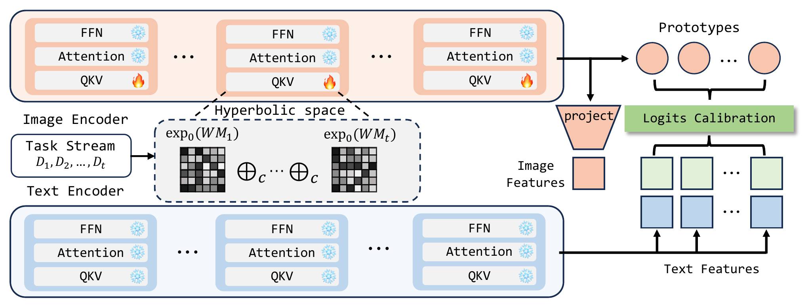
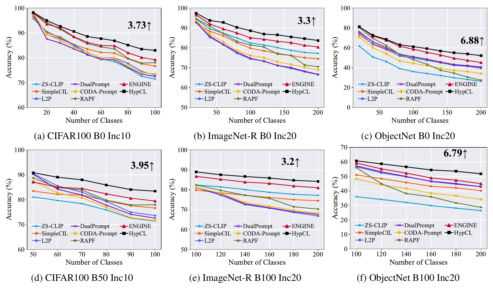

<div align="center">

<h1>HypCL: Adapting CLIP in Hyperbolic Space for Continual Learning</h1>


[](https://proceedings.mlr.press/v306/cheng26p.html) [](https://www.python.org/) [](https://pytorch.org/) [](https://opensource.org/licenses/MIT)

**[Paper](https://proceedings.mlr.press/v306/cheng26p.html)** &nbsp;·&nbsp; **[Overview](#overview)** &nbsp;·&nbsp; **[Results](#main-results)** &nbsp;·&nbsp; **[Getting Started](#getting-started)** &nbsp;·&nbsp; **[Citation](#citation)**

</div>

---

> **TL;DR:** HypCL adapts CLIP in hyperbolic space for exemplar-free continual learning.

---

## Overview

Existing CLIP-based continual learning methods usually freeze the backbone, which limits their ability to learn discriminative features. HypCL instead adapts CLIP in hyperbolic space, whose exponentially growing volume naturally accommodates an expanding class space.

<div align="center">

</div>

- **Hyperbolic adapters:** task-specific adapters on the visual encoder, composed sequentially in the Poincaré ball.
- **Hyperbolic classification:** predictions based on hyperbolic distances between image and text features.
- **Prototype calibration:** visual prototypes that calibrate predictions at inference.

## Main results

<div align="center">

</div>

## Getting started

### 1. Installation

```bash
conda create -n hypcl python=3.9 -y
conda activate hypcl
pip install -r requirements.txt
```

The backbone is OpenCLIP `ViT-B-16` with `laion400m_e32` weights, which OpenCLIP downloads and caches on the first run.

### 2. Data preparation

HypCL uses the same class subsets and train/test splits as ENGINE. Download the prepared datasets from the [ENGINE data instructions](https://github.com/RenaissCode/ENGINE#-requirements) and arrange them under one root:

```text
data/
├── cifar-100-python/          # downloaded automatically with --download
├── aircraft/{train,test}/
├── cars/{train,test}/
├── cub/{train,test}/
├── food101/{train,test}/
├── imagenetr/{train,test}/
├── objectnet/{train,test}/
├── sun/{train,test}/
└── ucf/{train,test}/
```

### 3. Usage Example

```bash
python main.py --config configs/cifar_0_10.json \
               --data-root /path/to/data \
               --output outputs/cifar_0_10
```

## Citation

If you find our work useful for your research, please star our project and cite our work.

```bibtex
@inproceedings{cheng2026hypcl,
  title     = {{H}yp{CL}: Adapting {CLIP} in Hyperbolic Space for Continual Learning},
  author    = {Quan Cheng and Hao Yu and Da-Wei Zhou and Lijun Zhang},
  booktitle = {Proceedings of the 43rd International Conference on Machine Learning (ICML)},
  pages     = {19099--19111},
  year      = {2026}
}
```


## Acknowledgements

This project builds upon excellent open-source work:

- [C3Box](https://github.com/LAMDA-CL/C3Box)
- [ENGINE](https://github.com/RenaissCode/ENGINE)
- [OpenCLIP](https://github.com/mlfoundations/open_clip)


## License

This project is licensed under the [MIT License](https://opensource.org/licenses/MIT).
